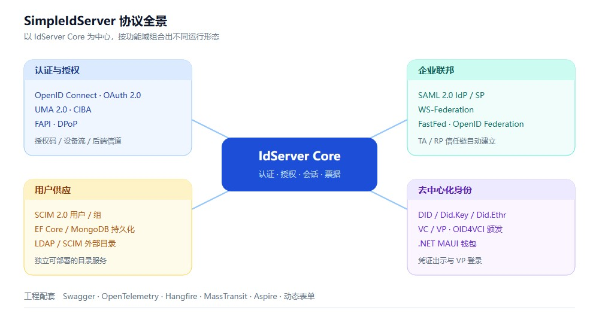
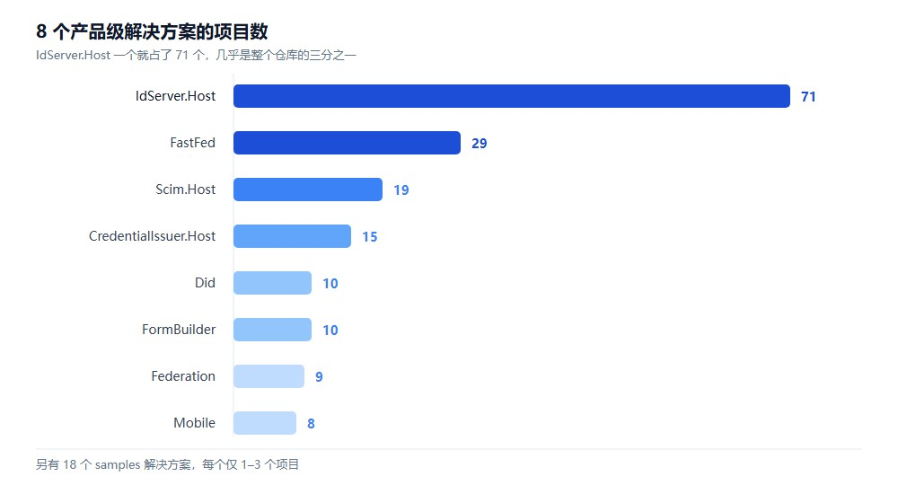
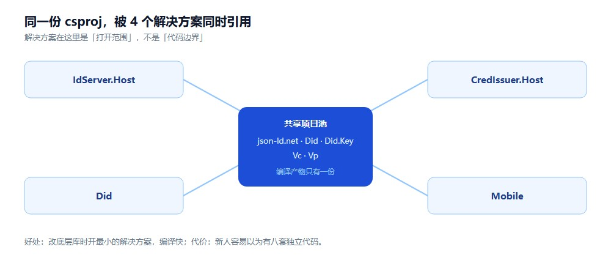
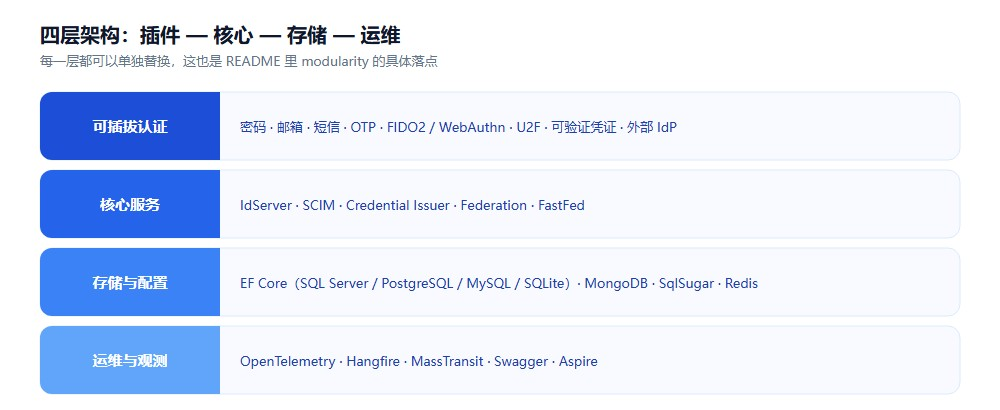

# SimpleIdServer：.NET 身份认证全家桶

**开源项目深读 · .NET 身份基础设施**

一个仓库，把认证服务器、用户目录、凭证颁发、联邦信任、动态表单与管理后台全部实现了一遍。

`Apache 2.0` · `7.0.0-rc2` · `.NET 10 LTS` · `187 个项目` · `26 个解决方案`

| 项目文件（csproj） | 解决方案 | 产品级解决方案 |
| :---: | :---: | :---: |
| **187** | **26** | **8** |

> 在 .NET 的身份认证开源版图里，SimpleIdServer 是一个很容易被低估的项目。它不是对某个 OIDC 库的薄封装，而是把身份基础设施的常见拼图一次做齐的开源框架。README 对它的定义很克制：一个支持 OPENID、OAUTH2.0、SCIM2.0、UMA2.0、FAPI 与 CIBA，用于简化定制访问控制服务器开发、配置与部署的框架，核心卖点是 **modularity and extensibility**。本文按代码结构拆一遍它到底装了什么，以及什么时候值得用它。

## 01　它解决的不是「签发一个 JWT」

很多身份类项目解决的是单点问题：做一个 OIDC Provider，或者包一层 OAuth2 客户端。SimpleIdServer 的目标是把拼图做齐——认证授权服务器、SCIM 用户与组目录、管理后台、可验证凭证颁发与钱包、企业联邦与信任链，都在同一个仓库里，彼此可以直接复用领域模型。

它同时提供两种用法：一是引用 NuGet 包，在已有项目里按需拼装；二是安装 dotnet 模板，直接生成一个可运行的服务器。README 给出的模板命令包括 `idserver`、`idserverwebsite`、`scim`、`credissuer`、`credissueradminui` 五个。

```bash
# 安装模板
dotnet new install SimpleIdServer.Templates

# 生成认证服务器 / 管理网站 / SCIM 服务
dotnet new idserver -n MyIdServer
dotnet new idserverwebsite -n MyAdmin
dotnet new scim -n MyScim
```

所以它更接近一套「身份平台源码」，而不是一个库。真正需要它的场景，通常是**私有化部署、协议需求杂、登录流程要按组织规则定制**的团队。

## 02　协议覆盖面：几乎把标准都实现了一遍



*图 1　按协议归类后的模块版图，四类能力都可按需组合*

把仓库里的模块按协议归类，大致是下面这张清单：

- **认证与授权**：OpenID Connect、OAuth 2.0、UMA 2.0、CIBA（客户端发起的后端信道认证）、FAPI 金融级安全规范、DPoP 令牌绑定
- **企业联邦**：SAML 2.0 的 IdP 与 SP、WS-Federation、FastFed 自动联邦配置、OpenID Federation 的 Trust Anchor 与 Relying Party
- **用户供应**：SCIM 2.0，支持 EF Core 与 MongoDB 两套持久化
- **去中心化身份**：DID、Did.Key、Did.Ethr、可验证凭证 VC 与可验证表述 VP、凭证颁发器，以及一个 .NET MAUI 钱包客户端
- **外围工程**：Swagger、OpenTelemetry、Hangfire 后台任务、MassTransit 事件、Aspire 编排

这些不是并列的独立产品，而是可以按需组合的运行形态。比如 IdServer 通过 SCIM Client 把用户写进目录服务，通过 Provisioning.SCIM / LDAP 从外部目录读用户，通过 VerifiablePresentation 支持 VP 登录，通过 Federation 模块参与信任链。

## 03　26 个解决方案，其实是同一套代码的不同视图

整个仓库有 187 个项目文件、26 个解决方案。根目录 7 个，formbuilder 子目录 1 个，其余 18 个在 samples 下，每个只含 1 到 3 个项目，用来演示「如何保护一个网站 / API」「如何跑 CIBA」「M2M 怎么取 token」这类单点场景。



*图 2　产品级解决方案规模对比，按项目数排序*

按项目数排序：`IdServer.Host` 71 个，几乎占整个仓库的三分之一；其后是 FastFed 29、Scim.Host 19、CredentialIssuer.Host 15、Did 10、FormBuilder 10、Federation 9、Mobile 8。另有 18 个 samples 解决方案，每个仅 1–3 个项目。

> **这里有个容易误读的点**：这些解决方案不是互斥的模块边界，而是「一次打开哪些项目」的开发视图。实测发现 `json-ld.net`、`Did`、`Did.Key`、`Vc`、`Vp` 五个项目同时出现在 4 个解决方案里；FormBuilder 的 8 个项目既在自己的解决方案里，也被 IdServer.Host 完整包含；`Scim.Client` 与 `Scim.Parser` 出现在 3 个解决方案里。编译产物仍只有一份。



*图 3　跨解决方案的共享项目关系*

这样做的好处是改底层库时开最小的解决方案、编译更快；代价是新人容易以为仓库里有八套独立代码。

## 04　架构上值得看的四个设计



*图 4　从认证插件到运维配套的分层视图*

### ① 认证方式插件化

密码、邮箱、短信、OTP、FIDO2、U2F、可验证凭证、外部身份源各自是独立项目，通过 IdServerBuilder 注册，登录流程与界面模板解耦。加一种自定义认证方式不必改核心授权逻辑。

### ② 存储层可换

EF Core 覆盖四种关系库迁移，SCIM 另有 MongoDB 持久化，Store 层还有 SqlSugar 实现；缓存与配置支持 SQL Server、Redis、PostgreSQL、SQLite。仓库甚至带了从 Duende IdentityServer 与 OpenIddict 迁移数据的工具项目。

### ③ 动态表单

登录、注册、找回密码、授权确认页不是写死的 Razor 视图，而由 FormBuilder 引擎加 Tailwindcss 驱动，表单定义可配置。按租户或场景改登录页，比改代码友好得多。

### ④ 可观测与运维

OpenTelemetry exporter、Hangfire 定时任务、MassTransit 集成事件、Swagger 文档、Aspire AppHost 与 ServiceDefaults 都有独立项目，不是事后补的示例代码。

## 05　工程现状与上手路径

当前主分支版本为 **7.0.0-rc2**。上游在 2026 年初做过一次整体升级，把 182 个项目从 `net8.0` 切到 `net10.0`（.NET 10 LTS），并同步升级了 FIDO 相关依赖。

最快的上手方式是模板：先执行 `dotnet new install SimpleIdServer.Templates`，再用 `dotnet new idserver` 生成服务器；`docker-compose.yml` 里已经配好 SQL Server、IdServer、SCIM、管理网站与凭证颁发器的组合，可以直接起一套本地环境。CI 侧有 psake 脚本与 Azure Pipelines 配置。

> **落地前建议确认三点**：一是依赖版本跨度较大，ASP.NET Core 与 EF Core 的 7.x、8.x、9.x 与 10.0 包在仓库里共存，大规模升级前建议先做依赖图收敛与多数据库回归；二是 DID / VC 相关解决方案依赖 `json-ld.net` 子模块，克隆时要带子模块；三是 MAUI 钱包需要安装对应工作负载才能构建。

## 06　适合谁，不适合谁

**适合**：需要私有化身份平台、且协议需求比较杂的团队；想顺着源码研究 OIDC、CIBA、FAPI、SCIM、联邦信任具体怎么落地的 .NET 工程师；希望 SCIM 目录与管理后台开箱即用的项目。

**不太适合**：只想要一个轻量 JWT 签发库，或者希望零运维直接接云身份服务的场景——那用更专注的方案会更省心。187 个项目的体量，对小型项目来说确实偏重。

---

> **一句话概括：SimpleIdServer 更像一份用 C# 写出来的身份协议参考实现全集。** 对不少团队来说，读它代码的价值，甚至不亚于直接把它部署起来。

---

*本文内容基于仓库实际代码结构整理 · 数据来自项目文件与解决方案清单实测*
